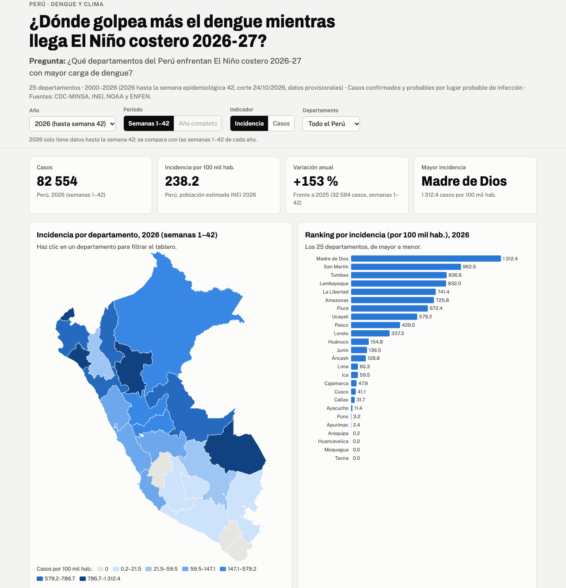
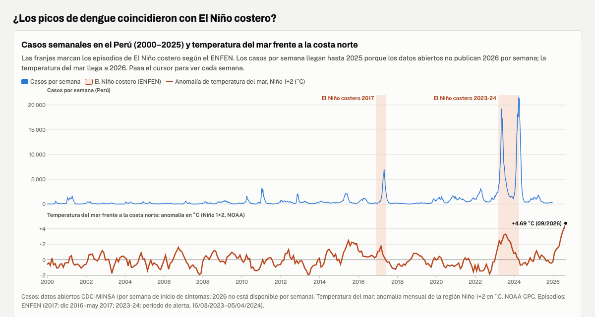

# Dengue y El Niño costero en el Perú

**Pregunta:** ¿Qué departamentos del Perú enfrentan El Niño costero 2026-27 con mayor carga de dengue?

**Dashboard:** https://jyauric.github.io/dengue-nino-peru/web/ · **Post de LinkedIn:** https://lnkd.in/p/eWXfSSUs

Proyecto de la Tarea 3 del curso Data Science con Python: del dato a la historia, con un dashboard interactivo y un reel con voz clonada por IA. Analiza los casos de dengue por departamento del Perú entre 2000 y 2026 (2026 hasta la semana epidemiológica 42), su incidencia por 100 mil habitantes y su coincidencia en el tiempo con los episodios de El Niño costero.




## Fuentes

| Dato | Fuente | Descarga |
|---|---|---|
| Casos de dengue 2000–2025, uno por fila | [CDC-MINSA, Plataforma Nacional de Datos Abiertos](https://www.datosabiertos.gob.pe/dataset/vigilancia-epidemiol%C3%B3gica-de-dengue) (licencia ODC-By) | 01/11/2026, `scripts/obtener_datos.py` |
| Casos 2026 por departamento (semanas 1–42) | [CDC-MINSA, sala situacional de metaxénicas](https://app7.dge.gob.pe/maps2/shiny_metaxenicas_web/), corte 24/10/2026, datos provisionales | 01/11/2026, descarga manual |
| Población por departamento 2000–2026 | [INEI, índice temático de población](https://m.inei.gob.pe/estadisticas/indice-tematico/population) (Boletín especial n.º 25) | 01/11/2026, `scripts/obtener_datos.py` |
| Temperatura del mar, región Niño 1+2 | [NOAA Climate Prediction Center](https://www.cpc.ncep.noaa.gov/data/indices/sstoi.indices) | 01/11/2026, `scripts/obtener_datos.py` |
| Episodios de El Niño costero | [ENFEN, comunicados oficiales](https://enfen.imarpe.gob.pe/comunicados/) 10-2017, 12-2017, 03-2023, 06-2024 y 19-2026 | Consulta 01/11/2026 |
| Límites distritales | INEI (GeoJSON con UBIGEO) | Copia del curso |

El registro de cada descarga automática está en `datos/originales/registro_descargas.csv`. El CSV de casos (118 MB) no se sube al repo por el límite de GitHub; `obtener_datos.py` lo vuelve a bajar.

## Metodología

- **Casos** = confirmados + probables, como los reporta el CDC; por departamento y distrito probable de infección y por semana de inicio de síntomas.
- **Incidencia** = casos ÷ población estimada del departamento en ese año × 100 000. La incidencia se calculó con la población estimada del INEI para cada año (2000–2026). En una muestra de departamentos, difiere menos de 1 % de la publicada por la sala situacional del CDC para 2023–2025; en 2026, hasta ~2 %.
- **Comparación con 2026:** como 2026 llega a la semana 42, cada año se corta en las semanas 1–42.
- **Validación:** los totales de 2025 (35 853 casos; 32 594 a la semana 42) y de 2026 (82 554) coinciden con la sala situacional del CDC.
- **El Niño costero:** franjas con las fechas del ENFEN (2017: dic 2016–may 2017; 2023-24: periodo de alerta del 16/03/2023 al 05/04/2024) y anomalía mensual de temperatura del mar Niño 1+2 de la NOAA.
- Lenguaje no causal: se describen coincidencias en el tiempo, no causas.

## Hallazgos

1. **La carga de 2026 se concentra en la costa norte y en la Amazonía.** Hasta la semana 42 de 2026, La Libertad (16 174 casos), Piura (14 761) y Lambayeque (11 506) suman el 51.4 % de los 82 554 casos del país. Por habitante, las mayores incidencias están en Madre de Dios (1 312 casos por 100 mil hab.) y San Martín (963), frente a 238 a nivel nacional.
2. **Los picos de dengue coincidieron con El Niño costero.** Durante El Niño costero 2017 se notificaron en promedio 2 168 casos por semana, y durante el de 2023-24, 6 816: unas 4 y 14 veces el promedio del resto de semanas de 2000–2025 (496). En ambos episodios, Tumbes y Piura tuvieron las mayores incidencias del país. Es una coincidencia en el tiempo; no demuestra que El Niño haya causado los brotes.
3. **2026 es el tercer año con más casos desde 2000 a la misma semana.** A la semana 42, 2026 suma 82 554 casos, 2.5 veces los de 2025 (32 594); solo lo superan 2024 y 2023. Entre los departamentos con más de 1 000 casos, los que más superan su propio promedio 2021–2025 son Pasco (2.5 veces), Madre de Dios (2.1) y San Martín (1.6), con El Niño costero 2026-27 en curso (ENFEN, comunicado n.º 19-2026) y la anomalía del mar Niño 1+2 en su valor más alto desde 2000 (+4.69 °C en septiembre de 2026).

Detalle y KPIs en [`hallazgos.md`](hallazgos.md).

## Limitaciones

- Análisis descriptivo: muestra coincidencia en el tiempo, no causalidad. No se analizan otros factores, como lluvias, temperatura del aire o presencia del vector.
- Los datos de 2026 son provisionales (corte 24/10/2026, semana 42); el 21.8 % de los casos son probables. Para 2026 no hay datos por distrito ni por semana.
- Población: estimaciones y proyecciones del INEI (2026 provisional). Para 2026, la sala situacional del CDC reporta para Tumbes una incidencia de 682.5 casos por 100 mil hab.; con la población del INEI, la incidencia es 836.6. En 2024 y 2025 ambas incidencias coinciden (diferencia menor a 1 %).
- Solo incluye casos notificados al sistema de vigilancia. Se mantienen 149 433 filas idénticas porque la base no trae un identificador; con ellas, los totales coinciden con el CDC.
- Solo se marcan los episodios de El Niño costero 2017 y 2023-24; no se revisaron episodios anteriores.

## Cómo reproducir

```bash
uv sync                                     # entorno principal (pyproject.toml)
uv run python scripts/obtener_datos.py      # descarga dengue, NOAA e INEI a datos/originales/
# las tablas de la sala situacional del CDC se descargan a mano (ver Fuentes)
uv run python scripts/procesar_datos.py     # limpieza, validación e indicadores -> datos/procesados/
uv run python web/construir.py              # arma web/index.html con los datos
uv run python scripts/figuras_reel.py       # imágenes del reel -> reel/recursos/
```

Exploración y análisis: `exploracion.ipynb` y `analisis.ipynb`.

**Reel** (entorno aparte, como en la sesión 15 del curso):

```bash
cd reel
uv venv .venv
uv pip install --python .venv/bin/python qwen-tts faster-whisper pillow imageio-ffmpeg soundfile jiwer num2words pypdf
.venv/bin/python hacer_reel.py --voz mi_voz.m4a --autor "Nombre Apellido" \
  --fuente "CDC-MINSA, INEI, NOAA y ENFEN · Música: Dreams Become Real, Kevin MacLeod (incompetech.com), CC BY 4.0" \
  --musica musica.mp3 --device mps --tts Qwen/Qwen3-TTS-12Hz-0.6B-Base
```

`reel.py` y `hacer_reel.py` son los de la sesión 15 con dos agregados: una imagen por escena y música de fondo. La grabación de voz (`reel/mi_voz.*`) no se sube al repo.

**Música:** "Dreams Become Real", Kevin MacLeod (incompetech.com). Licencia Creative Commons: By Attribution 4.0 (http://creativecommons.org/licenses/by/4.0/).

## Uso de IA

- **Claude (Anthropic)**, en Claude Code: apoyo para planificar, escribir el código (descarga, limpieza, dashboard, figuras y extensión del reel) y redactar textos.
- **Qwen3-TTS** para clonar mi voz y **Whisper** (faster-whisper) para los subtítulos del reel; la voz del video es generada con IA a partir de mi voz.
- Revisé las decisiones de análisis y verifiqué las cifras contra las fuentes oficiales (sala situacional del CDC, INEI, ENFEN).
